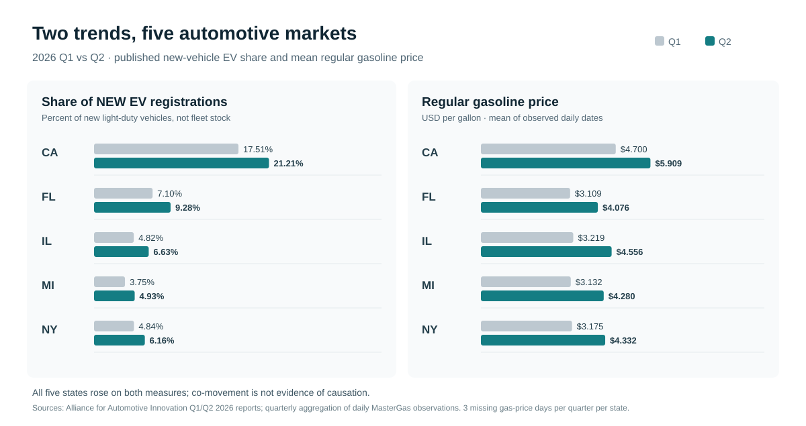

# Five-State Automotive Consumer Insights

### Gasoline price volatility and new EV registrations in 2026

*A reproducible, deliberately small portfolio study by **Sam Hakim***  
[hakimx.com](https://hakimx.com) · [GitHub: hakimxcom](https://github.com/hakimxcom)

**Research question:** How did regular gasoline prices and the share of **new** electric vehicle registrations move in California, Michigan, Florida, New York, and Illinois during the first half of 2026?

This project is for a consumer-insights reader at an automaker: it goes from messy daily observations to a defensible state comparison, transparently. It is **not** a forecast of GM or Hyundai sales, a survey of buyer motives, or a causal estimate of gas prices on EV adoption.

## One-minute overview

- **Five markets:** California (CA), Michigan (MI), Florida (FL), New York (NY), Illinois (IL).
- **Gas prices:** daily regular-grade observations from 2025–2026; compare mean prices in Q1 vs. Q2 2026, and plot the 2026 day-by-day path.
- **Vehicle demand indicator:** the share of *new light-duty vehicle registrations* in Q1/Q2 2026 that were BEVs, PHEVs, or FCEVs. Ordinary non-plug-in hybrid cars are **excluded**.
- **Unit of analysis:** state × quarter (10 rows). The daily price records are aggregated first to prevent accidentally counting the same EV share as dozens of separate observations.
- **Honest caveat:** with just two quarters and five markets, trends can be described but a cause cannot be established.

### First-half 2026: verified five-state snapshot



Both metrics increased across the five states. That is an observation, **not evidence that gasoline prices caused additional EV purchases**. See the [observed results and limitations](docs/observed_results.md) for precise Q1/Q2 values, data coverage and the exploratory comparison.

### Two stages: follow the reasoning, one file at a time

| Stage | File | Plain-English job |
|---|---|---|
| **I — Data preparation** | [01 clean_gas.py](stage_1_data/clean_gas.py) | Import the source CSV, select states, convert dollar-text prices, check duplicate days. |
| **I — Data preparation** | [02 prepare_ev.py](stage_1_data/prepare_ev.py) | Validate the ten EV observations manually transcribed from the industry reports. |
| **I — Data preparation** | [03 combine_audit.py](stage_1_data/combine_audit.py) | Calculate quarterly gasoline averages, merge by state and quarter, report missing dates. |
| **II — Analysis** | [04 describe.py](stage_2_analysis/describe.py) | Calculate gas price % changes, EV share percentage-point changes, exploratory rank correlation. |
| **II — Analysis** | [05 charts.py](stage_2_analysis/charts.py) | Save three straightforward, labeled graphs and explain what each means. |
| Both | [Methods](docs/methodology.md) · [Tests](tests/test_pipeline.py) | Read equations, source notes, assumptions, and small synthetic test cases. |

Each Python file starts with an explanation of its purpose, libraries, functions, inputs and outputs. Each meaningful calculation is in a named, documented function, so it can be explained without advanced programming knowledge.

## Reproduce on your computer

Python 3.10 or newer is recommended. Open a terminal in the repository folder.

1. Create an environment and install the three main scientific packages:

   ```bash
   python -m venv .venv
   # Windows PowerShell: .venv\Scripts\Activate.ps1
   # macOS/Linux: source .venv/bin/activate
   python -m pip install -r requirements.txt
   ```

2. Obtain the original **MasterGas.csv** and place it at `data/raw/MasterGas.csv`. See [the data instructions](data/README.md). **The raw third-party price dataset is intentionally not republished here.**

3. Run the two stages in order:

   ```bash
   # STAGE I — Collect, clean, combine, audit.
   python stage_1_data/clean_gas.py
   python stage_1_data/prepare_ev.py
   python stage_1_data/combine_audit.py

   # STAGE II — Analyze and visualize.
   python stage_2_analysis/describe.py
   python stage_2_analysis/charts.py

   # Optional: check code logic with small, invented inputs.
   python -m unittest discover -s tests -v
   ```

**Where to look:** `data/processed/market_quarterly.csv` is the ten-row combined research table. `outputs/stage_1_data_quality.md` lists missing prices; `outputs/state_changes_2026.csv` holds the five comparisons; `outputs/chart_*.png` has the three graphs. These are generated files, deliberately excluded from Git.

## Starting finding: EV share rose from Q1 to Q2 in all five states

The 2026 industry-report data (shares of **new light-duty registrations**, not all cars on the road):

| State | 2026 Q1 EV share | 2026 Q2 EV share | Change |
|---|---:|---:|---:|
| California | 17.51% | 21.21% | +3.70 pp |
| Florida | 7.10% | 9.28% | +2.18 pp |
| Illinois | 4.82% | 6.63% | +1.81 pp |
| Michigan | 3.75% | 4.93% | +1.18 pp |
| New York | 4.84% | 6.16% | +1.32 pp |

These changes are descriptive. A quarter-to-quarter rise does **not** demonstrate that consumers responded to gasoline-price changes; product supply, incentives, taxes, financing, charging availability and vehicle purchase timelines also matter.

The gasoline dataset we checked had **289 of 296** days present per state for January 1–October 23, 2026. Seven 2026 dates were missing in all five states: March 28–30, May 23, May 26–27, and October 8. Stage I explicitly tracks the gaps; it never manufactures missing values. If the source file changes, coverage will be recalculated.

## Sources and boundaries

1. [Alliance for Automotive Innovation — Q1 2026 Get Connected EV Report](https://www.autosinnovate.org/posts/papers-reports/Get%20Connected%20EV%20Quarterly%20Report%202026%20Q1.pdf).
2. [Alliance for Automotive Innovation — Q2 2026 Get Connected EV Report](https://www.autosinnovate.org/posts/papers-reports/Get%20Connected%20EV%20Quarterly%20Report%202026%20Q2.pdf).
3. [Public MasterGas.csv collection](https://github.com/jgreathouse9/AAAGas/blob/main/Prices/MasterGas.csv), which compiles observed AAA state price figures. Independent source collection: this study is not affiliated with AAA.

The tiny [EV reference CSV](data/reference/ev_market_share_2026.csv) contains only published, aggregated state figures and original source links. The third-party daily price file must be obtained separately, and its accuracy and reuse terms remain subject to the upstream source. Do not use this for individual-level inference, insurance underwriting, vehicle sales estimates, or causal analysis.

For the research design and four equations, see [methodology](docs/methodology.md). For a hiring-manager-oriented interpretation, see [the research note](docs/research_note.md).

---

**Created by Sam Hakim** · MSc Economics (Marketing) · Business research and analytics · [hakimx.com](https://hakimx.com)  
Licensed MIT for the original **code and documentation only**; upstream datasets retain their own terms.
